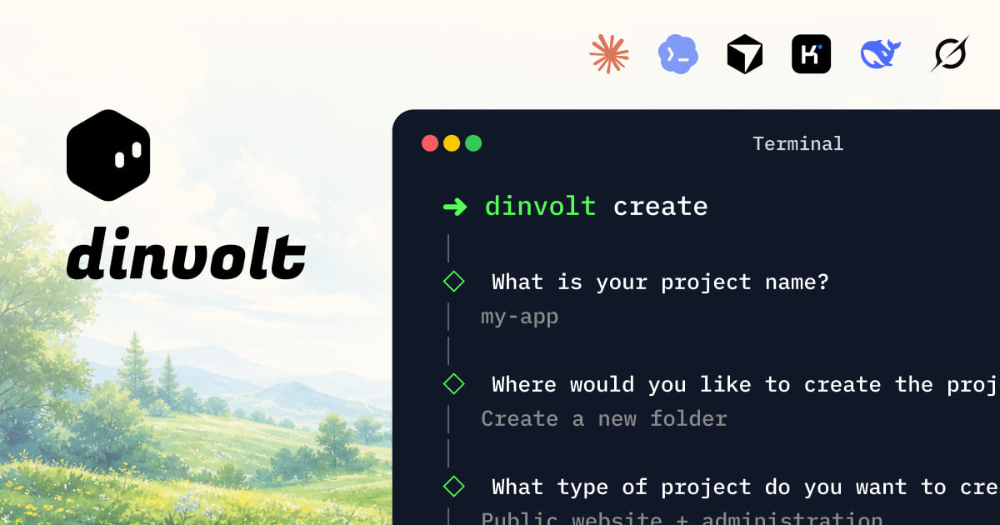

# Dinvolt

[](https://docs.dinvolt.com)

**Build your app. Skip the repetitive setup.**

Create a Next.js website or an application with an admin panel. Start with editable UI, development tools and context for your AI coding agent.

[Get started](#get-started) · [Official documentation](https://docs.dinvolt.com) · [Changelog](CHANGELOG.md)

## What you get

- **Code you own:** edit the pages, branding, themes and components in your project.
- **Ready for your agent:** project instructions and recommended skills for tools such as Codex and Claude Code.
- **Optional admin panel:** sign-in, user management, CSV exports and a database integration.

Choose your starting point in the wizard:

| Project type | Best for |
| --- | --- |
| **Public website only** | Landing pages, portfolios and informational websites. |
| **Public website + admin panel** | Applications with an admin panel, accounts and persistent data. |
| **Admin panel only** | Standalone internal apps, with marketing hosted separately. Login at `/`, protected home at `/dashboard`, and one shadcn/ui profile. |

See [what each project type includes](https://docs.dinvolt.com/project-types).

## Get started

Use **Node.js 24 or later**, **npm** and **Git**. Bun, pnpm and Yarn are also supported for the generated application.

### 1. Create your project

```sh
npx dinvolt@latest create
```

In the wizard:

1. Name your project, for example **my-app**, and choose **Create a new folder**.
2. Select a project type.
3. Choose **Advanced configuration** and select **npm** to follow the commands below.

Prefer Bun? Choose **Use Dinvolt defaults** for a new folder. For projects with an admin panel, you can select **Complete credentials later** and explore the public page or standalone login first.

### 2. Run locally

```sh
cd my-app
npm run dev
```

Open the URL printed in your terminal, normally **https://my-app.localhost**. Portless manages local HTTPS and may ask you to trust its certificate on first use.

Using another package manager? See the [quickstart](https://docs.dinvolt.com/quickstart) for its commands.

### 3. Build your application

Open the project in your coding agent and describe what you want to build. For example:

```text
Create a portfolio for a freelance designer with a project gallery,
an about section and a contact page. Use a clean layout, large typography
and warm colors.
```

Keep the development server running to see your changes.

<details>
<summary>Create a project from an agent or script</summary>

```sh
npx --yes dinvolt@latest create \
  --name my-app \
  --location new \
  --project-type public \
  --package-manager npm \
  --json
```

This creates a public website without prompts and returns JSON. See the [agent prompt](https://docs.dinvolt.com/agents/project-prompt) or [all creation options](https://docs.dinvolt.com/reference/create#non-interactive-creation).

</details>

## Next steps

Follow [Next steps](https://docs.dinvolt.com/next-steps) for the path that matches your project.

### Set up your admin panel

If you deferred setup, create a database with the provider you selected: **Turso** or **PlanetScale Postgres**. Then run this inside your generated project:

```sh
npx dinvolt setup
```

The wizard connects your database, initializes the authentication tables and offers to create your first administrator. Restart the development server, then sign in at `/admin` (or `/` for **Admin panel only**).

See the [admin panel setup walkthrough](https://docs.dinvolt.com/next-steps#set-up-your-admin-panel) for credentials and sign-in steps.

### Add UI components

For example, add a button and dialog to the public website:

```sh
npx dinvolt ui add button dialog --target public
```

Browse [components and blocks](https://docs.dinvolt.com/ui/blocks) for more options, including admin components.

## Documentation

Read the full guides at **[docs.dinvolt.com](https://docs.dinvolt.com)**.

| I want to… | Guide |
| --- | --- |
| Connect Turso or PlanetScale Postgres | [Database](https://docs.dinvolt.com/guides/database) |
| Manage administrators, sessions or password recovery | [Authentication](https://docs.dinvolt.com/guides/authentication) |
| Query data and create API procedures | [API and data](https://docs.dinvolt.com/guides/data) |
| Extend the admin panel screens | [Admin panel](https://docs.dinvolt.com/ui/admin-panel) |
| Publish my application | [Deploy with Vercel](https://docs.dinvolt.com/guides/vercel) |
| Find a command or automate setup | [CLI reference](https://docs.dinvolt.com/reference/cli) |
| Use the installed agent skills | [Agent skills](https://docs.dinvolt.com/agents/skills) |

## Tech stack

| Area | Tools |
| --- | --- |
| Application | Next.js, React, TypeScript |
| Interface | Tailwind CSS, shadcn/ui, Base UI |
| Development | Portless, Ultracite with Oxlint and Oxfmt by default |
| Database and authentication | Drizzle, Turso or PlanetScale Postgres, Better Auth |
| API and data | tRPC, TanStack Query, TanStack Table |
| Forms and email | React Hook Form, Zod, Resend, React Email |

Projects with an admin panel include the database, authentication, API, forms and email tools. Password recovery requires configuring Resend and a sender address.

## Keep a Changelog skill

Use Dinvolt's changelog skill in any repository, with any stack:

```sh
npx skills add nicoandrade/dinvolt --skill keep-a-changelog
```

Then ask your agent:

```text
Use keep-a-changelog to review the changes, choose the next version
and update the changelog.
```

New Dinvolt projects include it when skill installation is enabled. It prepares version and changelog files; publishing is a separate step. See [agent skills](https://docs.dinvolt.com/agents/skills#install-keep-a-changelog-separately).

## Contributing

To work on Dinvolt itself, start with [Contributing](CONTRIBUTING.md) for repository structure, local setup and checks. See the [playground guide](playground/README.md) for UI previews and the [documentation guide](apps/docs/README.md) for the docs site.

Report vulnerabilities using the [security policy](SECURITY.md).

## License

Dinvolt's own code is available under the [MIT license](LICENSE). Third-party components retain their own terms, including the Nucleo UI icons; see [third-party notices](THIRD_PARTY_NOTICES.md).
